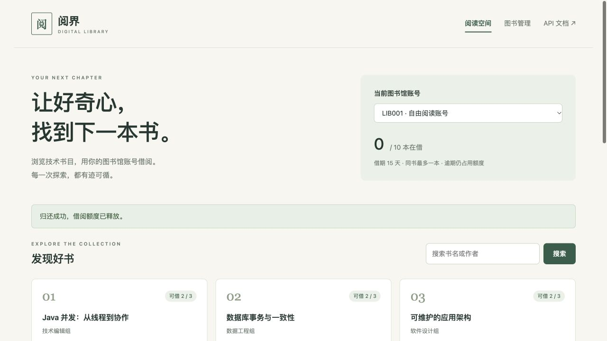
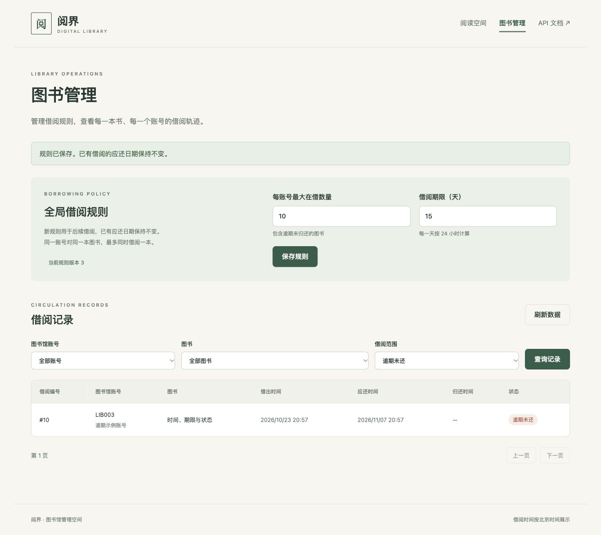

# 阅界 · 电子图书馆

Java 17 / Spring Boot / MyBatis 后端技术作业：浏览、详情、借阅、归还、当前借阅，以及读者和管理网页。

按图书馆账号独立借阅，不关联自然人。默认每账号最多在借十本、借期十五天、同书最多一本。逾期不自动归还，仍占用数量；管理员可修改全局额度与借期，已有应还时间保持不变。

代码阅读顺序与约定见 [技术方案](docs/technical-design.md#3-应用与接口)。

## 直接运行：只需要 JDK 17

~~~sh
./mvnw spring-boot:run
~~~

| 入口       | 地址                                  |
| ---------- | ------------------------------------- |
| 读者页面   | http://localhost:8080                 |
| 管理页面   | http://localhost:8080/admin           |
| Swagger UI | http://localhost:8080/swagger-ui.html |
| OpenAPI    | http://localhost:8080/v3/api-docs     |

默认 demo 模式使用 H2 文件数据库和 Java 本地锁，无需安装 MySQL、Redis 或 Node.js。首次需要联网下载 Maven 和依赖。数据保存在工作目录的 data/library.mv.db，重启不覆盖借阅及规则。Windows 使用 mvnw.cmd。

~~~sh
./mvnw clean package
java -jar target/digital-library-1.0.0.jar
~~~

PORT 可调整端口，LIBRARY_DATA_PATH 可调整 H2 文件前缀。构建产物为可执行 JAR。

## 演示数据

| 账号   | 初始状态     | 可演示场景                       |
| ------ | ------------ | -------------------------------- |
| LIB001 | 当前零本     | 正常借还、重复归还、重借         |
| LIB002 | 当前九本     | 再借一本达到十本上限             |
| LIB003 | 一笔逾期未还 | 逾期占用数量，但额度内仍可继续借 |
| LIB004 | 一笔归还历史 | 管理查询历史                     |

预置十五本书；图书 9 的唯一授权已借出，图书 14 初始只有一个可用名额。种子时间在首次迁移时生成，之后不会重置。

通过 X-Library-Account-Id 模拟账号，不是真实认证。管理入口只实现功能操作，不包含登录、权限、账号/图书维护或管理员代还。

## 完整模式：MySQL 8.4 与 Redis 8.4

~~~sh
docker compose up --build
~~~

应用端口8080，MySQL 本机映射3307，Redis 映射6380。可复制 .env.example 为 .env 调整本地演示配置。MySQL 使用具名卷，docker compose down 保留数据。

启动共享同一个数据库和 Redis 的第二个应用实例（端口8081）：

~~~sh
docker compose --profile concurrency up --build
~~~

只启动依赖，再从本机运行：

~~~sh
docker compose up -d mysql redis
SPRING_PROFILES_ACTIVE=full \
LIBRARY_DB_URL='jdbc:mysql://localhost:3307/library?connectionTimeZone=UTC&forceConnectionTimeZoneToSession=true' \
LIBRARY_DB_USERNAME=library \
LIBRARY_DB_PASSWORD=library \
LIBRARY_REDIS_ADDRESS=redis://localhost:6380 \
./mvnw spring-boot:run
~~~

Redis 只用于锁，没有数据缓存。完整模式获取锁失败时拒绝借还，不自动切换成本地锁；查询仍走数据库。Redisson 懒连接保证 Redis 初始不可用时，应用也能启动并提供读取。

## API 合约

| 方法与路径                             | 功能                             |
| -------------------------------------- | -------------------------------- |
| GET /api/accounts                      | 预置账号                         |
| GET /api/books?keyword=&page=0&size=20 | 按书名、作者分页浏览             |
| GET /api/books/{bookId}                | 图书详情                         |
| POST /api/loans                        | 借阅，请求体包含 bookId          |
| POST /api/loans/{loanId}/return        | 按具体借阅记录幂等归还           |
| GET /api/loans/current                 | 当前账号未归还借阅，含逾期       |
| GET /api/borrowing-policy              | 全局规则                         |
| GET /api/admin/loans                   | 按 accountId、bookId、scope 筛选 |
| PUT /api/admin/borrowing-policy        | 使用 expectedVersion 修改规则    |

借还及当前借阅需 X-Library-Account-Id。分页从零开始，size 默认20、最多100，结果为 items/page/size/hasNext。图书按 ID 升序，借阅按 ID 降序。管理 scope 为 ALL、CURRENT、OVERDUE、RETURNED；CURRENT 包含逾期。

~~~sh
curl 'http://localhost:8080/api/books?size=6'

curl -X POST http://localhost:8080/api/loans \
  -H 'Content-Type: application/json' \
  -H 'X-Library-Account-Id: 1' \
  -d '{"bookId":14}'

curl http://localhost:8080/api/loans/current \
  -H 'X-Library-Account-Id: 1'
~~~

归还使用借阅响应中的 id，它与图书 ID、当前关系 ID 不同。更多请求见 [API 示例](docs/api-examples.http)；另提供实际导出的 [OpenAPI 快照](docs/openapi.json)，完整合约以运行时 OpenAPI 为准。

时间为 UTC ISO 8601，页面按北京时间展示。错误为 application/problem+json，含稳定 code 和 requestId，并与响应头 X-Request-Id、日志对应。业务冲突409，锁失败503。COMMIT_OUTCOME_UNKNOWN 表示提交结果未确认，先查询记录，不直接重放借阅。

## 模型与一致性

| 模型／表                           | 职责                 |
| ---------------------------------- | -------------------- |
| LibraryAccount / library_account   | 图书馆账号与当前数量 |
| Book / book                        | 书目及有限授权名额   |
| Loan / loan                        | 完整历史及规则快照   |
| BorrowingPolicy / borrowing_policy | 全局规则及版本       |
| current_loan                       | 当前关系及唯一约束   |

每张业务表均有独立 id。不建立数据库 FOREIGN KEY；关联字段有中文注释，程序在事务内验证存在与匹配。current_loan 使用 INSERT SELECT，从真实、未归还且账号图书匹配的 loan 建立关系。唯一约束与数量 CHECK 保留。

- Redis 互斥直接使用 Redisson RLock；数据访问、连接池、事务、迁移分别使用 MyBatis、HikariCP、Spring 事务、Flyway。
- 先账号锁、再图书锁，反向释放；通过 Spring 事务管理器显式开启、提交或回滚，事务完成后才解锁。
- 数量变更使用带边界条件的原子 UPDATE，数据库保护不依赖 Redis 锁永不失效。
- 归还先条件写入 returned_at，只有影响一行的事务才能释放数量，后续失败整体回滚。
- 当前关系唯一约束允许保留多次借还历史。
- 每次借阅只读一份规则，保存快照；旧快照在途请求可完成，新请求使用新版本。

详见 [技术方案](docs/technical-design.md)、[业务场景与流程图](docs/system-analysis.md)。

## 测试

默认测试不需要 Docker。生产和测试的数据库操作都通过 MyBatis Mapper 与 XML 执行；测试专用 SQL 位于 `src/test/resources/mapper/test`，独立检查数量和关联一致性：

~~~sh
./mvnw test
~~~

真实组件测试：

~~~sh
./mvnw -Pfull-it verify
~~~

full-it 通过 Testcontainers 创建 MySQL 8.4、Redis 8.4，并启动两个独立 HTTP 应用实例。覆盖跨实例竞争、重复归还、删除已持有 Redis 锁造成重叠执行、服务故障及初始不可用。缺少 Docker 明确失败，不静默跳过。

也可使用专门的、可清空的外部测试实例：

~~~sh
LIBRARY_IT_EXTERNAL_IS_DISPOSABLE=true \
LIBRARY_IT_DB_URL='jdbc:mysql://127.0.0.1:3307/library_it' \
LIBRARY_IT_DB_USERNAME=library \
LIBRARY_IT_DB_PASSWORD=library \
LIBRARY_IT_REDIS_ADDRESS=redis://127.0.0.1:6380 \
./mvnw -Pfull-it verify
~~~

外部模式会清空指定测试库的业务表并操作锁键，仅用于独立测试实例。它不停止调用方的 Redis；故障场景改为关闭应用锁客户端，并另启连接不可用端点的实例。

实际结果及未验证项见 [验证报告](docs/verification.md)。H2、其他本机版本与 Docker 目标版本的证据分别记录。

## 观察与取舍

- /actuator/health 分别展示数据库、锁服务状态；完整模式锁检查会产生一次有超时的 Redis 读取。
- /actuator/health/readiness 仅依赖应用与数据库，Redis 故障保留读服务。
- 日志包含请求、账号、图书和借阅 ID，以及锁等待、操作耗时和结果。
- 本地锁用于单实例演示，完整模式验证分布式协调；没有进行性能基准测试。
- 热门图书借还串行且存在 Redis 往返成本，未承诺吞吐提升。
- H2 文件模式方便评审，但不能替代 MySQL 的真实行为验证。

## 页面

